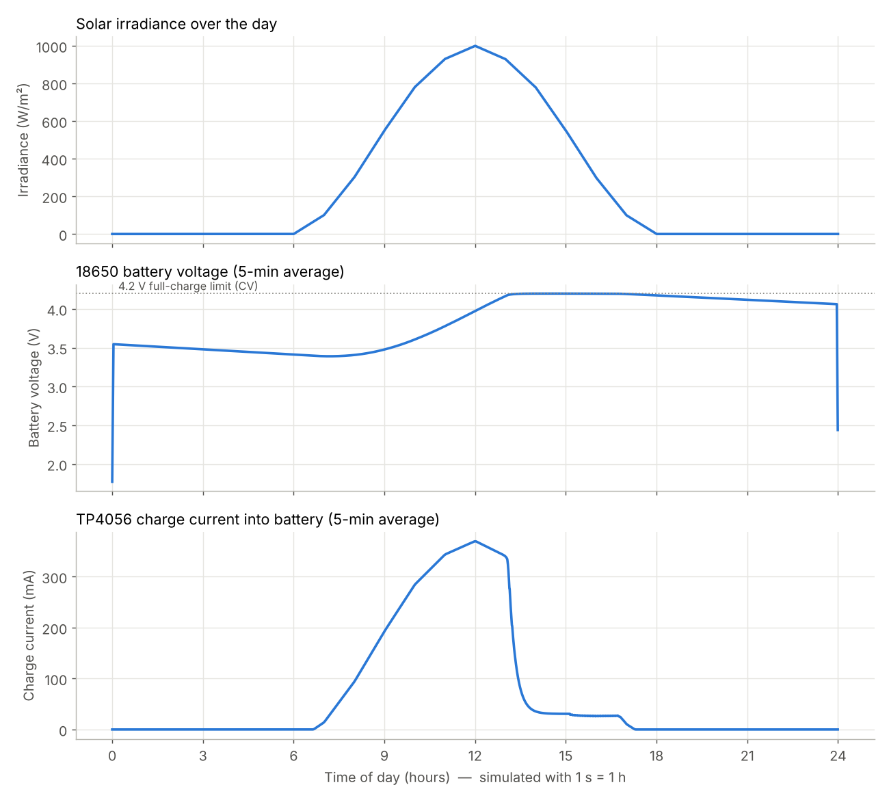
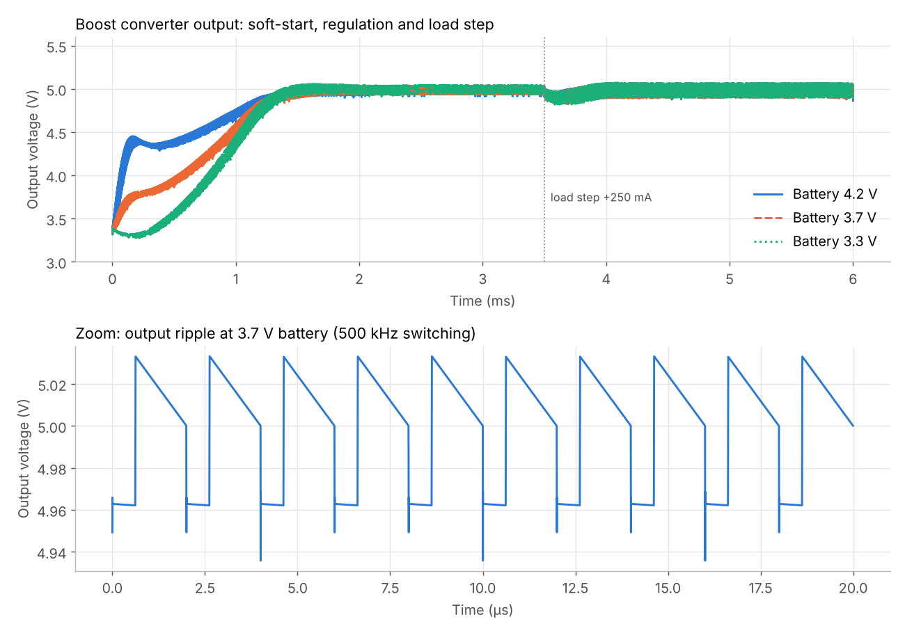

# Solar-Powered Portable Water Quality Monitoring System

B.Tech first-year multidisciplinary project, VIT Vellore.

A portable, solar-powered device that measures **pH, turbidity, temperature** and a **colorimetric heavy-metal signal**, then gives an instant, rule-based **IS 10500:2012 safety verdict**. It uses no AI: every decision comes from fixed threshold rules.

**Live links**
- ▶ Wokwi simulation: https://wokwi.com/projects/477928222740105217
- 📊 Dashboard: https://vit-water-quality-monitor.streamlit.app

Start the Wokwi simulation, open the dashboard, and the **Live device** tab shows the virtual device's readings within a few seconds.

This repository holds the **software side** of the project:

| Part | Folder | What it shows |
|---|---|---|
| **1. Working simulation (Wokwi)** | [`firmware/wokwi/`](firmware/wokwi) | The ESP32 firmware running on a virtual circuit: sensors → rule engine → LCD + status LED + buzzer → MQTT telemetry |
| **2. Dashboard (Streamlit)** | [`dashboard/`](dashboard) | Live readings from the device, a what-if simulator, and the rules/standards page |
| **3. Power circuit simulation (LTspice)** | [`ltspice/`](ltspice) | Solar panel → TP4056 charger → 18650 battery over 24 h, plus the 3.7 V → 5 V boost converter |
| Tests | [`tests/`](tests) | Checks that the firmware and the dashboard give the **same verdict** for the same inputs |

---

## 1. Wokwi simulation (ESP32)

**Run it:** open the [saved project](https://wokwi.com/projects/477928222740105217) and press ▶. To rebuild it from scratch, open a new ESP32 project on [wokwi.com](https://wokwi.com). Replace `sketch.ino` and `diagram.json` with the files from `firmware/wokwi/`. Add `rules.h` (tab menu → *New file*) and `libraries.txt` (*Library Manager* → *+*, or paste the file). Then press ▶.

| Control in Wokwi | Stands in for | Try this |
|---|---|---|
| Slide pot **pH** (GPIO 34) | pH probe module | Slide left → *pH too acidic* → UNSAFE |
| Slide pot **Turbidity** (GPIO 35) | Turbidity sensor | Push right → >1 NTU CAUTION, >5 NTU UNSAFE |
| **Photoresistor** lux (GPIO 32) | Colorimeter light sensor (LED through cuvette) | Lower the lux (darker sample) → absorbance rises → CRITICAL heavy metal |
| **DS18B20** temperature (GPIO 4) | Water temperature probe | Set above 40 °C → CAUTION |
| Knob **Battery V** (GPIO 33) / **Solar V** (GPIO 36) | Voltage dividers on battery and panel | Watch LCD power page: CHARGE / NO SUN / LOW BATTERY |
| **CAL BLANK** button (`c` key) | — | Stores the current light level as the clean-water reference *I_blank* |
| **NEXT PAGE** (`n`) / **MUTE** (`m`) | — | Cycle LCD pages / silence buzzer |

LCD pages rotate every 3 s: **readings → verdict + reasons → power → network/Fe estimate**.

Status LED colours: green = SAFE, yellow = CAUTION, red = UNSAFE, flashing red = CRITICAL.

The firmware publishes JSON every 2 s to the MQTT broker `broker.hivemq.com`, topic `vit-wqm/cooldude3579/device01/telemetry`. The same JSON is printed on the serial monitor.

**Moving to real hardware:** set `#define SIMULATION 0` at the top of `sketch.ino`. The same code then uses the real conversion formulas:
- pH: two-point buffer calibration
- turbidity: SEN0189 curve
- battery and solar: divider ratios

Fill in the calibration constants after measuring with your actual parts.

## 2. Dashboard

```bash
pip install -r dashboard/requirements.txt
streamlit run dashboard/app.py
```

- **Live device:** shows the verdict, readings, battery/solar status and trend charts while the Wokwi simulation (or the real board) is running. A clearly labelled demo stream is available if no device is online.
- **Simulator:** sliders and preset scenarios run through the same rule engine.
- **Rules & standards:** the decision matrix and how the colorimeter works (Beer–Lambert).

## 3. LTspice power simulation

Open the `.asc` files in LTspice and press **Run**. Details are in [`ltspice/README.md`](ltspice/README.md).

| Result (verified with ngspice on the same netlist) | Value |
|---|---|
| Energy harvested by a 6 V / 2 W panel on a clear day | **6.4 Wh** |
| Energy used (1 W for 30 s every 5 min, 10 mW sleep) | **3.1 Wh** |
| Battery at start of day → end of day | **3.55 V → 4.06 V** (energy-positive) |
| Boost output at battery 4.2 / 3.7 / 3.3 V | **5.00 / 5.00 / 5.00 V** |
| Boost output after a +250 mA WiFi load step | recovers to 5.00 V in ≈0.5 ms |




## Safety verdict rules (IS 10500:2012)

| Parameter | Limit | Condition | Verdict |
|---|---|---|---|
| pH | 6.5 – 8.5 | outside range | UNSAFE |
| Turbidity | ≤ 1 NTU acceptable, ≤ 5 NTU permissible | 1 < NTU ≤ 5 / NTU > 5 | CAUTION / UNSAFE |
| Temperature | ambient | > 40 °C, or sensor missing | CAUTION |
| Heavy metal (colorimetric) | Fe ≤ 1.0 mg/L | absorbance > 0.20 AU | CRITICAL |

The worst result wins: CRITICAL > UNSAFE > CAUTION > SAFE.

## Tests

```bash
python3 tests/run_tests.py
```

This runs 13 water samples through both the C++ rule engine (`firmware/wokwi/rules.h`) and the Python one (`dashboard/rules.py`), checks they agree, and compile-checks the full sketch.

## Hardware notes for the build team

- The **TP4056 accepts at most ~5–6 V input**, so use a **6 V solar panel**. Connecting a 12 V panel directly destroys it. A 12 V panel needs a buck converter in front.
- Read analog sensors only on ADC1 pins (GPIO 32–39): ADC2 stops working while WiFi is on.
- Put a 220 Ω resistor in series with each RGB LED leg, and a 4.7 kΩ pull-up on the DS18B20 data line.
- Bring 5 V sensor outputs down to 3.3 V with dividers before they reach the ESP32 (e.g. 10 k / 20 k for the turbidity module).
